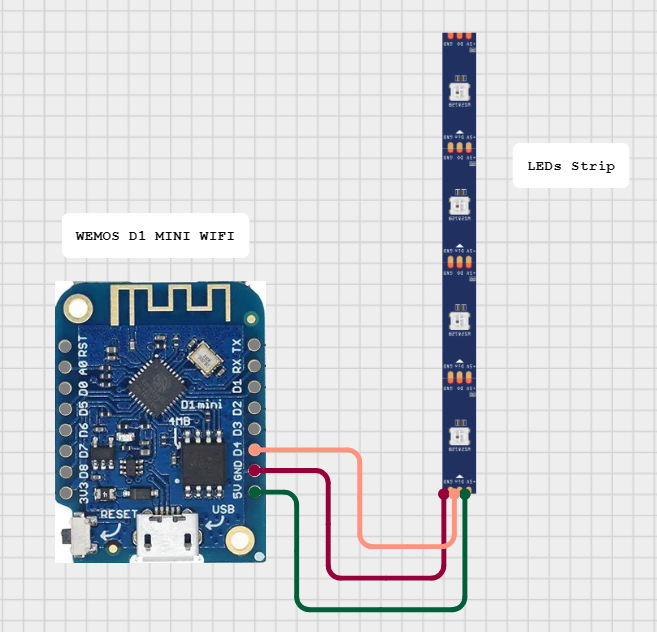

# 🕹️ LED Score Controller - Extension Chrome & Arduino

Système complet de scoreboard LED contrôlé via une extension Chrome, avec animation de victoire et personnalisation des couleurs. Parfait pour afficher les scores d'un jeu de Pong ou tout autre jeu à deux joueurs !



---

## 📋 Table des matières

- [Fonctionnalités](#-fonctionnalités)
- [Matériel requis](#-matériel-requis)
- [Schéma de câblage](#-schéma-de-câblage)
- [Installation](#-installation)
- [Configuration](#️-configuration)
- [Utilisation](#-utilisation)
- [API Arduino](#-api-arduino)
- [Structure du projet](#-structure-du-projet)
- [Captures d'écran](#-captures-décran)

---

## ✨ Fonctionnalités

### Extension Chrome
- 🎨 **Interface cyber/quantique** avec effets néon
- 📡 **Indicateur de ping** en temps réel
- 🎮 **Mode manuel** : Contrôle direct des scores
- ⚡ **Mode automatique** : Synchronisation avec une page web (`#player1-score` et `#player2-score`)
- 🎨 **Personnalisation des couleurs** pour chaque joueur
- 💡 **Contrôle de luminosité** (0-100%)
- 🏆 **Animation de victoire** automatique (premier à 5 points)
- 🔄 **Reset** complet (scores + couleurs)

### Arduino (ESP8266)
- 🌈 **10 LEDs NeoPixel** (5 par joueur)
- 🎯 **Animation idle** quand aucun score n'est affiché
- 🏆 **Animation de victoire** clignotante (3 secondes)
- 🎨 **Couleurs personnalisables** via API
- 💡 **Luminosité réglable**
- 📡 **Serveur HTTP** pour contrôle à distance
- 🔔 **Notification Discord** au démarrage (IP)

---

## 🛠️ Matériel requis

| Composant | Quantité | Description |
|-----------|----------|-------------|
| **WEMOS D1 Mini** | 1 | Microcontrôleur ESP8266 avec WiFi |
| **Bande LED NeoPixel** | 10 LEDs | WS2812B ou compatible (5V) |
| **Alimentation 5V** | 1 | Capable de fournir 2A min |
| **Câbles dupont** | 3 | Pour connexions (VCC, GND, DATA) |

### Spécifications
- **LED Strip** : 10 LEDs adressables (NeoPixel/WS2812B)
- **Pin de données** : D4 (GPIO2)
- **Tension** : 5V
- **Courant max** : ~600mA (10 LEDs à pleine luminosité blanche)

---

## 🔌 Schéma de câblage


### Connexions

| WEMOS D1 Mini | LED Strip | Alimentation |
|---------------|-----------|--------------|
| D4 (GPIO2) | DATA IN | - |
| 5V | VCC | + 5V |
| GND | GND | GND |

**⚠️ Important :**
- Alimenter le WEMOS via USB
- Relier le GND commun entre WEMOS, LEDs et alimentation
- Ne pas dépasser 5V pour les LEDs
- Ajouter un condensateur 1000µF entre VCC et GND (optionnel mais recommandé)

---

## 📥 Installation

### 1️⃣ Arduino (ESP8266)

#### Prérequis
- Arduino IDE 2.x
- Support ESP8266 installé
  - Installer le support ESP8266 (boards Wemos)
    - File → Preferences → Additional Boards Manager URLs
    - Lien : http://arduino.esp8266.com/stable/package_esp8266com_index.json
- Bibliothèques :
  - `Adafruit_NeoPixel` (installable via Library Manager)
  - `ESP8266WiFi` (inclus avec le support ESP8266)
  - `ESP8266WebServer` (inclus avec le support ESP8266)
  - `ESP8266HTTPClient` (inclus avec le support ESP8266)

#### Configuration
1. Ouvrir `Arduino_src/score_leds/score_leds.ino`
2. Modifier les paramètres WiFi :
   ```cpp
   const char* ssid = "VOTRE_SSID";
   const char* password = "VOTRE_MOT_DE_PASSE";
   ```
3. (Optionnel) Configurer le webhook Discord :
   ```cpp
   const char* webhook_url = "https://discord.com/api/webhooks/...";
   ```
4. Téléverser sur le WEMOS D1 Mini
5. Ouvrir le moniteur série (115200 bauds) pour voir l'adresse IP

### 2️⃣ Extension Chrome

1. Ouvrir Chrome et aller dans `chrome://extensions/`
2. Activer le **Mode développeur** (coin supérieur droit)
3. Cliquer sur **Charger l'extension non empaquetée**
4. Sélectionner le dossier `Extension/`
5. L'extension apparaît dans la barre d'outils

---

## ⚙️ Configuration

### Premier lancement

1. **Cliquer sur l'icône de l'extension**
2. **Entrer l'IP de l'Arduino** (ex: `IP`)
   - Visible dans le moniteur série au démarrage
   - Ou via le message Discord si configuré
3. **Cliquer sur "Enregistrer"**
4. Le statut passe à **ONLINE** avec le ping affiché

### Modes d'utilisation

#### Mode Manuel
1. Entrer les scores manuellement (0-5)
2. Cliquer sur **"Envoyer Score"**
3. Les LEDs s'allument en conséquence
4. **Animation de victoire** si un joueur atteint 5

#### Mode Automatique
1. Naviguer vers une page contenant :
   - `<div id="player1-score">3</div>`
   - `<div id="player2-score">2</div>`
2. Activer le **Mode automatique**
3. Les scores sont synchronisés automatiquement (scan toutes les 500ms)

---

## 🌐 API Arduino

### Endpoints disponibles

#### `GET /health`
Vérifier l'état du serveur
```bash
curl http://IP/health
# Réponse : OK
```

#### `GET /score`
Obtenir les scores actuels
```bash
curl http://IP/score
# Réponse : {"scoreA":3,"scoreB":2}
```

#### `GET /score?a=X&b=Y`
Définir les scores
```bash
curl "http://IP/score?a=3&b=2"
# Réponse : OK
```

#### `GET /color`
Obtenir les couleurs actuelles (RGB)
```bash
curl http://IP/color
# Réponse : {"colorA":[0,0,255],"colorB":[255,0,0]}
```

#### `GET /color?ar=R&ag=G&ab=B&br=R&bg=G&bb=B`
Définir les couleurs (0-255 par composante)
```bash
curl "http://IP/color?ar=0&ag=255&ab=255&br=255&bg=0&bb=255"
# Cyan pour A, Magenta pour B
```

#### `GET /brightness`
Obtenir la luminosité actuelle
```bash
curl http://IP/brightness
# Réponse : {"brightness":128}
```

#### `GET /brightness?value=X`
Définir la luminosité (0-255)
```bash
curl "http://IP/brightness?value=200"
# Réponse : {"brightness":200}
```

#### `GET /reset`
Réinitialiser tout (scores, couleurs, luminosité)
```bash
curl http://IP/reset
# Réponse : RESET
```

---

## 📁 Structure du projet

```
Transcendance_LEDS/
│
├── Arduino_src/
│   └── score_leds/
│       └── score_leds.ino          # Code Arduino ESP8266
│
├── Extension/
│   ├── manifest.json               # Configuration Chrome Extension
│   ├── popup.html                  # Interface utilisateur
│   ├── popup.js                    # Logique de l'interface
│   ├── background.js               # Service worker (requêtes HTTP)
│   ├── content.js                  # Script d'injection (mode auto)
│   └── styles.css                  # Thème cyber/quantique
│
├── schema.png                      # Schéma de câblage
└── README.md                       # Ce fichier
```

---

## 🎮 Utilisation

### Scénario 1 : Jeu de Pong local
1. Lancer le jeu de Pong sur votre machine
2. Activer le **Mode automatique**
3. Les scores sont synchronisés en temps réel
4. Animation de victoire à 5 points

### Scénario 2 : Contrôle manuel
1. Utiliser les champs **Player A** et **Player B**
2. Ajuster les scores manuellement
3. Cliquer sur **"Envoyer Score"**
4. Utiliser le bouton **Reset** pour remettre à zéro

### Scénario 3 : Personnalisation
1. Ouvrir la section **"Couleurs LED"**
2. Choisir les couleurs avec les color pickers
3. Ajuster la luminosité avec le slider
4. Cliquer sur **"Appliquer"**

---

## 🎨 Personnalisation

### Couleurs prédéfinies

| Couleur | RGB | Exemple |
|---------|-----|---------|
| Bleu | `(0, 0, 255)` | Défaut Player A |
| Rouge | `(255, 0, 0)` | Défaut Player B |
| Cyan | `(0, 255, 255)` | Style néon |
| Magenta | `(255, 0, 255)` | Style néon |
| Vert | `(0, 255, 0)` | Classique |
| Jaune | `(255, 255, 0)` | Vif |
| Blanc | `(255, 255, 255)` | Neutre |

### Animation Idle
Quand aucun score n'est affiché (état initial), les LEDs effectuent une animation :
- Un point bleu va-et-vient sur les 5 LEDs de gauche
- Un point rouge va-et-vient sur les 5 LEDs de droite
- Intensité réduite (1/3 de la luminosité)

### Animation de victoire
Quand un joueur atteint 5 points :
1. **Arduino** : Clignotement rapide de toutes les LEDs (3 secondes)
2. **Extension** : Overlay plein écran avec effets cyber
3. Affichage continu de la couleur du gagnant après l'animation

---

## 🔧 Dépannage

### L'extension ne se connecte pas
- ✅ Vérifier que l'Arduino est allumé et connecté au WiFi
- ✅ Vérifier l'adresse IP dans le moniteur série
- ✅ Tester avec `curl http://IP/health` dans un terminal
- ✅ S'assurer que le PC et l'Arduino sont sur le même réseau

### Les LEDs ne s'allument pas
- ✅ Vérifier l'alimentation 5V
- ✅ Vérifier les connexions (DATA sur D4)
- ✅ Tester la luminosité (peut-être à 0%)
- ✅ Vérifier le type de LEDs dans le code (`NEO_GRB` vs `NEO_RGB`)

### Le mode automatique ne fonctionne pas
- ✅ Vérifier que les éléments `#player1-score` et `#player2-score` existent
- ✅ Ouvrir la console développeur (F12) pour voir les erreurs
- ✅ Recharger l'extension après modification

### Les couleurs ne correspondent pas
- ✅ C'est normal ! Les LEDs et les écrans ont des gammes colorimétriques différentes
- ✅ Ajuster manuellement dans l'extension pour compenser
- ✅ Vérifier l'ordre RGB/GRB dans le code Arduino

---

## 🚀 Améliorations futures

- [ ] Sauvegarde des préférences (couleurs, luminosité)
- [ ] Mode "partie" avec historique des scores
- [ ] Support de plusieurs bandes LED
- [ ] Interface web responsive pour mobile
- [ ] Support MQTT pour domotique
- [ ] OTA (mise à jour sans fil du firmware)
- [ ] Effets d'animation personnalisables

---

## 📜 Licence

Projet open-source - Libre d'utilisation et de modification

---

## 👤 Auteur

Créé avec ❤️ pour le projet Transcendance

**Technologies utilisées :**
- Chrome Extension (Manifest V3)
- ESP8266 / Arduino
- NeoPixel / WS2812B
- HTML/CSS/JavaScript
- C++ (Arduino)

---

## 🙏 Remerciements

- Adafruit pour la bibliothèque NeoPixel
- ESP8266 Community
- Chrome Extensions Documentation

---

**🎮 Bon jeu et que le meilleur gagne ! 🏆**